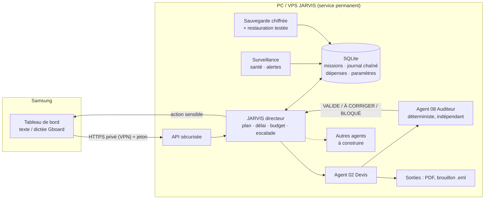

# 02 — Architecture

## Principe

JARVIS est **un logiciel déployé** (un service qui tourne), pas une conversation. Tout l'état est dans **un fichier SQLite** : on peut arrêter, redémarrer ou migrer la machine sans perdre une mission.

## Schéma

## Chaîne de contrôle de chaque mission

`DEMANDE → PLANIFICATION → EXÉCUTION → CONTRÔLE INDÉPENDANT → (CORRECTION ×3 max) → VALIDATION HUMAINE ou ESCALADE → ARCHIVAGE`

| Statut | Signification | Qui décide |
|---|---|---|
| `EN_FILE` / `EN_COURS` | En attente / en traitement (avec bail) | moteur |
| `A_CORRIGER` | L'auditeur a refusé, correction ciblée demandée | auditeur |
| `EN_ATTENTE_APPROBATION` | Audit validé, action sensible : **attend ton clic** | toi |
| `BLOQUE` | Information ou autorisation manquante, **une question t'est posée** | toi |
| `VALIDE` | Audit validé et, si sensible, approuvé par toi | auditeur + toi |
| `ECHEC` | 3 corrections ou 3 reprises épuisées : escalade | toi |
| `REFUSE` | Tu as refusé | toi |

**Règle** : le statut vient de l'auditeur, **jamais de la déclaration de l'agent**.

## Fichiers (`jarvis/src/`)

| Fichier | Rôle |
|---|---|
| `db.js` | SQLite, transactions, **journal chaîné par hachage** |
| `moteur.js` | Dépôt, baux anti-doublon, reprise, arrêt d'urgence, budget |
| `orchestrateur.js` | JARVIS directeur : plan, exécution avec délai, audit, corrections, porte humaine |
| `agents/devis.js` | Agent 02 (calculs en entiers, PDF, brouillon mail) |
| `auditeur.js` | Agent 08 : **n'importe aucun code d'agent**, recalcul BigInt, lecture des fichiers |
| `confiance.js` | Règle de confiance : seule la source `canal_utilisateur` donne des ordres ; détection d'injection/secrets ; masquage |
| `serveur.js` + `public/` | API et tableau de bord |
| `sauvegarde.js` | AES-256-GCM, vérification par restauration |
| `sante.js`, `metriques.js` | Alertes et mesures calculées sur l'état réel |
| `demarrer.js` | Service : serveur + boucle + surveillance + sauvegarde quotidienne |

## Ajouter un agent sans rien reconstruire

Un agent = un objet `{ nom, role, sensible, plan(), executer(mission, ctx) }` + une fonction d'audit enregistrée dans `AUDITEURS`. Il reçoit un contexte (données, paramètres, délai, `depenser()`), et ne peut ni envoyer, ni écrire dans EBP : seul le moteur le fait, après approbation. **Un même processus peut tenir plusieurs rôles** tant que l'**auditeur reste indépendant** (c'est le cas : pas d'import croisé).

## Pourquoi ces choix

| Choix | Raison | Compromis |
|---|---|---|
| Node 22 sans dépendance | Même base que tes deux dépôts ; rien à compiler sur Windows | `node:sqlite` encore classé expérimental |
| SQLite (fichier unique) | Transactionnel, sauvegardable, zéro serveur à administrer | Une seule machine ; pas de cluster |
| Contrôles déterministes | Un second modèle IA peut se tromper comme le premier | Les contrôles sont à écrire à la main pour chaque type de mission |
| Calculs en entiers | Aucun arrondi flottant, aucune « hallucination » de montant | — |
| Modèles IA **pas** dans le prototype | La supervision et les règles doivent marcher **même si un fournisseur est en panne** (c'est vrai par construction : le prototype n'appelle aucun modèle) | Le langage libre reste à brancher |

## Architecture IA hybride (à construire, non présente)

Chaque agent déclarera son **fournisseur de modèle** (interface unique), avec repli : modèle en ligne par API pour raisonner/rédiger, modèle local pour ce qui est privé ou répétitif. Règles : toute sortie de modèle passe par l'auditeur ; aucun montant n'est calculé par un modèle ; les données envoyées sont **minimisées** (références et quantités, pas le fichier client). Choix de modèle à faire sur **mesure réelle** (qualité sur tes cas, coût par mission, latence), pas sur réputation.
