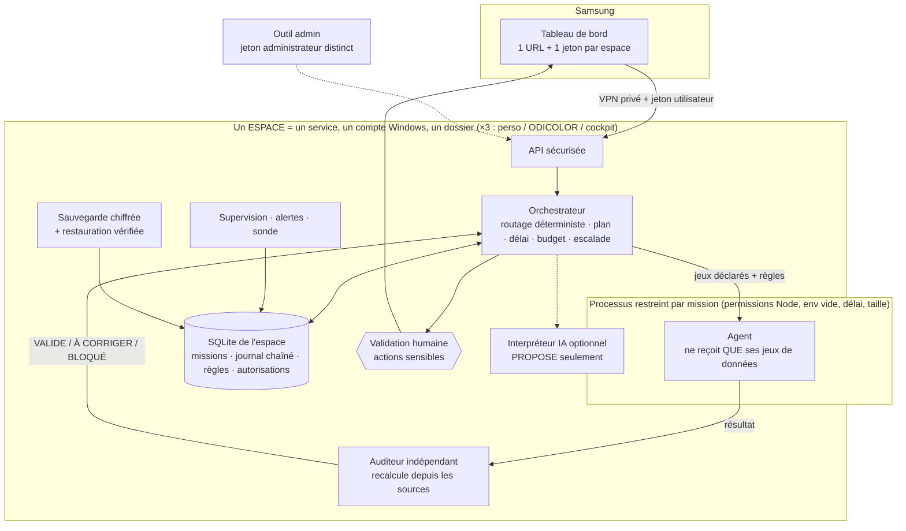

# 02 — Architecture (v2)

## Principe

JARVIS est **un logiciel déployé** (services qui tournent), pas une conversation. **Un service par espace** ; tout l'état d'un espace est dans **son** fichier SQLite : on peut arrêter, tuer ou migrer sans perdre une mission (testé avec `kill -9`).

## Schéma

## Chaîne de contrôle d'une mission

`DEMANDE → ROUTAGE → PLAN → EXÉCUTION (agent isolé) → CONTRÔLE INDÉPENDANT → (CORRECTION ×3 max) → VALIDATION HUMAINE ou ESCALADE → ARCHIVAGE`

| Statut | Signification | Qui décide |
|---|---|---|
| `EN_FILE` / `EN_COURS` | Attente / traitement (avec bail anti-doublon) | moteur |
| `A_CORRIGER` | L'auditeur a refusé ; correction ciblée | auditeur |
| `EN_ATTENTE_APPROBATION` | Audit validé, action **sensible** : attend ton clic | toi |
| `BLOQUE` | Information, règle ou autorisation manquante : **une question te est posée** | toi |
| `VALIDE` | Audit validé (et approuvé par toi si sensible) | auditeur + toi |
| `ECHEC` | 3 corrections ou 3 reprises épuisées : escalade | toi |
| `REFUSE` | Refusé par toi | toi |

Le statut vient de l'**auditeur** ; la sensibilité vient de **sa** table (un agent ne peut pas se déclarer « non sensible »).

## Les trois espaces (cloisonnement)

| | Personnel | ODICOLOR | Cockpit |
|---|---|---|---|
| Agents | Planification | **les 8** | Planification (+ connecteur facultatif) |
| Données réelles | désactivées | **désactivées** sans autorisation | désactivées |
| Intégrations (EBP, Gmail, Airtable) | — | désactivées, **non développées** | — |
| Connecteur | — | — | « ordres d'atelier » : **seulement si autorisé** |
| Dossier / base / journal / sauvegardes / jeton / jeton admin / clé / port | **à lui** | **à lui** | **à lui** |

Aucun processus ne voit deux espaces. La configuration est **refusée** si deux espaces partagent un dossier, une base, un port, un jeton ou une clé (testé).

## Rôles et droits

| Acteur | Peut | Ne peut pas |
|---|---|---|
| **Agent** | Lire ses jeux déclarés ; écrire dans le dossier de sa mission | Lire la base, d'autres espaces, l'environnement ; lancer un processus ; (réseau : *non filtré par Node*) |
| **Orchestrateur** | Attribuer, planifier, corriger, escalader | Accorder un droit, modifier une règle (n'importe pas ces fonctions : vérifié) |
| **Utilisateur** (jeton) | Missions, validations, arrêt d'urgence, lecture | Règles, autorisations |
| **Administrateur** (jeton distinct) | Règles, autorisations | Créer des missions |

## Fichiers (`jarvis/src/`)

| Fichier | Rôle |
|---|---|
| `orchestrateur.js` | Chaîne de contrôle, porte humaine, détail d'une décision |
| `routage.js` | Attribution déterministe des demandes (ambiguïté ⇒ question) |
| `executeur.js`, `agents/runner.js` | Exécution isolée (ou directe pour les tests) |
| `agents/*.js` | Les 8 agents + outils communs |
| `auditeurs/*.js` | L'auditeur indépendant (un module par agent) |
| `regles.js` | Règles justifiées/validées + autorisations |
| `espaces.js` | Profils, configuration, vérification du cloisonnement |
| `integrations.js` | Garde des intégrations (désactivées, non développées) |
| `modeles.js` | Interface IA hybride avec garde-fous |
| `db.js`, `moteur.js` | SQLite, journal chaîné, file persistante, baux, reprise, budget |
| `serveur.js`, `public/` | API, tableau de bord |
| `sante.js`, `metriques.js`, `sauvegarde.js` | Supervision, mesures, sauvegarde chiffrée |

## Ajouter un agent

Un agent = une fabrique `{ nom, role, droits, criteres, plan(), executer(mission, ctx) }` + un auditeur qui **recalcule** depuis les sources, enregistrés dans `agents/index.js` et `auditeurs/index.js`, + son type dans la table de sensibilité. Les tests structurels exigent : droits déclarés, ≥ 3 critères, aucun import interdit, auditeur sans import d'agent.

## IA hybride (Windows + IA en ligne, modèle local plus tard)

`modeles.js` : fournisseurs interchangeables essayés dans l'ordre configuré (ex. **local d'abord** — gratuit et privé —, **en ligne en secours**). Le modèle **propose** une reformulation d'une demande incomprise ; tu confirmes. Il ne reçoit que **le texte de ta demande** (e-mails/téléphones masqués), **jamais les données**. Sa sortie est validée (agent actif de l'espace, longueur, injection, secrets). Chaque appel est **facturé au budget** ; budget atteint ou panne totale ⇒ JARVIS continue en mode déterministe. **Aucun fournisseur réel n'est branché** ; ajouter un modèle local = fournir un objet `{ appeler, coutCents }`.

## Pourquoi ces choix

| Choix | Raison | Compromis |
|---|---|---|
| Node 22 sans dépendance | Même base que tes dépôts ; rien à compiler sur Windows | `node:sqlite` et le modèle de permissions : à surveiller à chaque mise à jour de Node |
| Un service par espace | Cloisonnement par processus, compte et dossier | 3 services à superviser |
| Agents déterministes | Reproductibles, auditables, aucun coût de modèle | Pas de langage libre sans modèle |
| Contrôles par recalcul | Un second modèle peut se tromper comme le premier | Un auditeur à écrire par type de mission |
